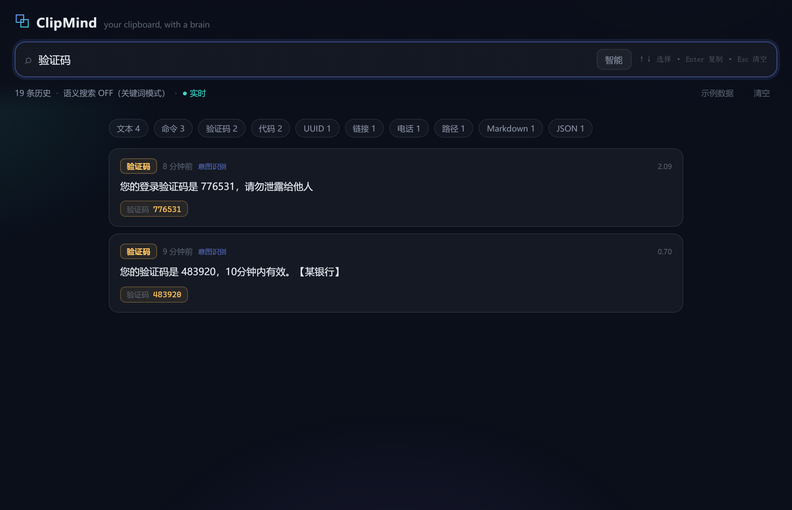

<div align="center">

# ⧉ ClipMind

**Your clipboard, with a brain.**

Local-first clipboard history with semantic search and smart content extraction.
Everything stays on your machine — nothing is ever uploaded.

[](.github/workflows/ci.yml)
[](pyproject.toml)
[](LICENSE)
[](#privacy--security)

[English](README.md) · [简体中文](README.zh-CN.md)

</div>

---

Copy a verification code, a URL, a hex color… and 10 minutes later you need it
again — but `Win+V` string-matching can't find *"that code from the bank SMS"*.

ClipMind fixes that. It watches your clipboard, **understands what each item
is** (OTP, link, email, phone, JSON, color, command…), and lets you search by
*meaning*, not by exact characters.



> Searched "验证码" (verification code). Note the golden one-tap **776531**
> chip — copy just the code, not the whole SMS. No embeddings installed;
> intent recognition did this offline.

## ✨ Highlights

| | |
|---|---|
| 🔍 **Search by meaning** | *"那个 github 链接"* finds it — even when the clip contains neither "github" nor "链接" as text. Hybrid FTS + vector ranking with graceful degradation. |
| 🧠 **Knows what it's looking at** | 14 content types detected out of the box: OTP codes, URLs, emails, phones, JSON, hex/rgb colors, shell commands, paths, IPs, UUIDs, code, markdown, tables. |
| ⚡ **One-tap entity copy** | Copy *just* the verification code, *just* the URL, *just* the phone number — not the whole blob around it. |
| 🔒 **Privacy-first** | Single SQLite file on your disk. Zero network by default. Optional local ONNX embeddings stay offline too. |
| 🛡️ **Secret-safe by design** | Skips passwords, TOTP seeds, private keys, JWTs, API tokens — via shape/entropy heuristics — *before* they are ever stored. |
| 🔴 **Live feed** | New clips appear instantly (WebSocket). Copy counter surfaces your most-used items. |
| 🧩 **Zero heavy deps** | Core installs in seconds. Semantic layer is an optional extra. |
| 🇨🇳 **CJK-native search** | Trigram tokenizer — substring search that actually works for Chinese. |

## 🚀 Quick start

```bash
pip install clipmind          # from PyPI (or see "from source" below)
clipmind                      # starts the server, opens the UI
```

Then:

- **`Ctrl+Shift+V`** — open the ClipMind panel from anywhere
- Type a query — try *"验证码"*, *"github"*, *"颜色"*, *"链接"*, or just describe it
- **Enter** copies the selected item · **↑↓** navigate · **Esc** clears
- Click any **golden/green chip** to copy just that entity (the OTP digits, the URL, …)

> First run on an empty clipboard? Hit **示例数据** (sample data) in the top bar
> to see what ClipMind can do.

### Enable semantic search (optional, still offline)

```bash
pip install 'clipmind[semantic]'   # fastembed + a tiny local ONNX model
```

Or point it at any OpenAI-compatible embeddings endpoint:

```bash
export CLIPMIND_API_KEY=sk-...
export CLIPMIND_API_EMBEDDING_BASE_URL=https://api.openai.com/v1  # or your own
clipmind
```

Without either, ClipMind still works — keyword + intent + behavioural
ranking only. **The UI never breaks because the model didn't load.**

### From source

```bash
git clone https://github.com/clipmind/clipmind
cd clipmind
pip install -e .          # dev: pip install -e '.[dev]'
clipmind demo             # seed sample history
clipmind                  # go
```

## 🔍 Search modes

| Mode | How it ranks | Use when |
|---|---|---|
| **智能 / auto** | BM25 + cosine + intent + recency + usage | default — almost always |
| **语义 / semantic** | vectors only | "concept" queries, e.g. *"something about deployment"* |
| **精确 / keyword** | FTS only | you remember exact characters |

Intent magic: queries mentioning a content *type* ("链接", "验证码",
"颜色", "command", "email") boost and recall clips of that kind — even with
zero embeddings installed.

## 🖥️ CLI

```console
$ clipmind search 验证码
 1. [otp      ]  2.09 您的登录验证码是 776531，请勿泄露给他人
— 1 hits in 1 ms (mode=auto, semantic=False)

$ clipmind add "remember this for later"
$ clipmind status
$ clipmind extract "otpauth://…"        # see what the extractor thinks
$ clipmind demo                         # seed sample history
```

`python -m clipmind …` works too. Config lives in `~/.clipmind/config.toml`
(optional — every key has a sane default, see
[docs/configuration.md](docs/configuration.md)).

## 🔒 Privacy & Security

- **Storage**: one SQLite file (`~/.clipmind/clipmind.db`). Delete it, and
  the history is gone. No cloud, no accounts, no telemetry.
- **Network**: none by default. The only outbound call happens if *you*
  configure an embeddings API — and it only ever sends the text you search
  for, not your history.
- **Secret guard**: before storing anything, ClipMind checks for TOTP seeds,
  private key blocks, GitHub/Slack/AWS token shapes, JWTs, and high-entropy
  password-like strings, plus a user-configurable blocklist.
  [`clipmind extract "sk-..."`](#-cli) to test what would be skipped.
- **Hotkey & server**: binds `127.0.0.1` only. The UI is not exposed to your
  LAN.

## 🗺️ Roadmap

- [ ] Image clips (screenshots) + OCR text extraction
- [ ] Tauri desktop shell (true global overlay window)
- [ ] Encrypted-at-rest mode (SQLCipher)
- [ ] Pinyin & fuzzy matching layer
- [ ] Cross-device sync (end-to-end encrypted, opt-in)
- [ ] Clipboard "paste templates" (fill-in-the-blank snippets)

Pull requests welcome — especially for the 🛡️ secret-detection heuristics,
which thrive on real-world patterns.

## 🤝 Contributing

```bash
pip install -e '.[dev]'
pytest
```

Small, focused PRs. New detector = new tests. See
[CONTRIBUTING.md](CONTRIBUTING.md).

## License

[MIT](LICENSE) © ClipMind contributors
